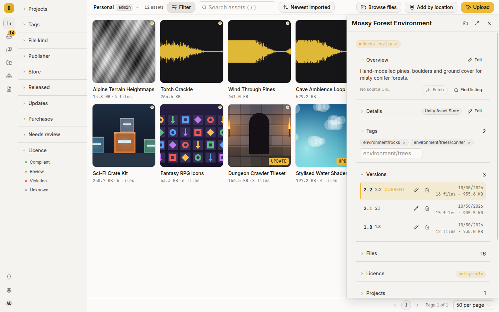
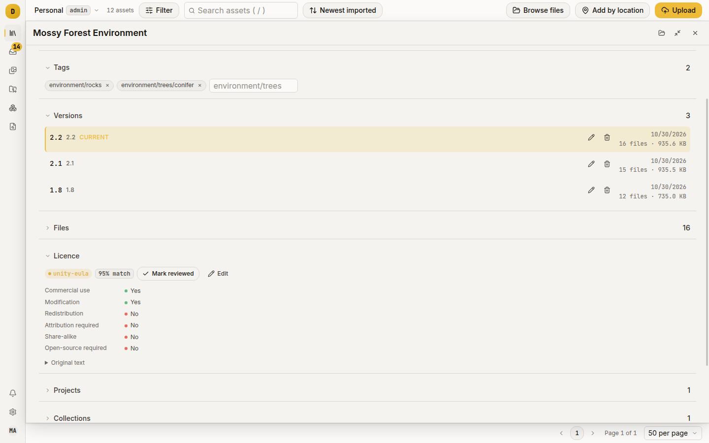

# Damson

A self-hosted catalogue for the asset packs a game team buys and reuses.

Damson turns the `.unitypackage` files, zipped kits and loose textures on a shared drive into something you can search and preview, and answers the question that matters on ship day: are we allowed to use this?

It is one Go binary that serves its own web UI, backed by Postgres and either the local filesystem or an S3-compatible object store.

> Damson is pre-alpha. It is a single-process application with no HA story, no backup tooling of its own, and no upgrade guarantees between versions. Read [Project status](#project-status) before you put anything you care about in it.

To run it, start with [Getting started](docs/getting-started.md).

## What it does

- Extracts what you upload. A `.unitypackage` or `.zip` is unpacked into its individual files; anything else is stored whole. Thumbnails and previews are rendered from the contents: resampled images, waveforms for audio, type specimens for fonts.
- Tracks the licence. Each asset has one licence, with the terms broken out as six yes/no/*unknown* attributes: commercial use, modification, redistribution, attribution, share-alike, open-source required. *Unknown* is a third state, never silently a "no". Filter a library by what it permits, or open a project and see whether anything in it blocks a commercial release.
- Pulls the storefront listing. Where it can, Damson finds the Unity Asset Store page for a pack and brings back the description, publisher, cover art and tags.
- Versions assets. Uploading a newer build of a pack you already have never overwrites it: it is stored as its own asset, and when Damson recognises the match it offers to fold it in as a new version. Projects pin the version they ship.
- Organises three ways. Tags are hierarchical paths describing what an asset *is*; collections are flat bookmarks recording what you *decided* about it; projects pin versions for a build. They are not interchangeable.
- Keeps libraries apart. A library is the tenancy boundary: assets, tags, projects, settings and the audit log each belong to exactly one, and you only see a library you are a member of.
- Has a CLI. `dmsn` uses the same HTTP API for scripts and agents. `dmsn sync` bulk-imports Unity's local Asset Store cache, usually the fastest way to fill a new library.

## Who it is for

A small game team, or one person with a decade of Asset Store purchases, who wants the packs catalogued on their own hardware without a per-seat subscription. It assumes you can run a container and a Postgres, and would rather read a configuration reference than click through a setup wizard.

It is not a general-purpose DAM for marketing collateral, and it is not version control for your project's source assets. It catalogues things you acquired.

## What it looks like

Signing in opens **Library**: a paged, virtualised grid of asset tiles, with a quick-look panel that opens beside it and a package page behind that with the pack's files. **Tags** on the toolbar opens a picker that steps through the store categories; an asset under any ticked tag matches. **Filters** holds the rest: licence status, needs review, updates, projects, publisher, store, release date and file kind. Whatever is set shows as a chip under the toolbar. **Tag index** on the left rail shows every tag with covers from inside it. The rail also links to **Triage** (live-updating: every asset that needs review, imports in progress or failed, and previews still rendering), **Projects**, **Collections**, the **Audit log**, **Settings**, and a **Notifications** panel, where Damson offers to fold a new upload into a pack you already have.

## Documentation

Running Damson:

- [Getting started](docs/getting-started.md): install with Docker Compose, bootstrap the first admin, upload your first asset
- [Configuration reference](docs/configuration.md): every environment variable and its default, plus the OIDC and S3 setups
- [How-tos](docs/how-to/README.md): [licences](docs/how-to/track-licences.md),
  [Unity packages](docs/how-to/import-unity-packages.md),
  [versions and pins](docs/how-to/pin-versions.md),
  [multiple libraries](docs/how-to/separate-libraries.md),
  [collections](docs/how-to/collections.md)
- [Observability](docs/observability.md): log shape, request correlation, and useful queries

Building Damson:

- [CONTRIBUTING.md](CONTRIBUTING.md): set up a dev environment and what a good pull request looks like here
- [AGENTS.md](AGENTS.md): the commands and the dev loop, for people and coding agents
- [docs/architecture.md](docs/architecture.md): how the system fits together, and the traps
- [docs/CONVENTIONS.md](docs/CONVENTIONS.md): coding standards, handler patterns, test helpers
- [docs/design-system.md](docs/design-system.md): frontend tokens and primitives
- [docs/e2e-flows.md](docs/e2e-flows.md): what the Playwright suite covers

## Project status

Damson is pre-alpha:

- One process, no HA. There is no clustering or read replica story. Scaling means a bigger box.
- No backup tooling. Back up the Postgres database and the object store (`/data/blobs` in local mode, or your bucket) together, the database *after* storage. See [Backups](docs/getting-started.md#backups).
- Gaps with no UI yet. Creating a library is an API call; the web UI can only rename, delete and switch between them. The how-tos name these gaps.
- No upgrade guarantees. Migrations run forward automatically at startup and there is no downgrade path. Nothing stops you upgrading across several versions at once, and nothing promises it will work.

Releases are the `v*.*.*` git tags, published as images at `ghcr.io/thomas-elliott/damson`. The image tags drop the `v`: each release is tagged `X.Y.Z`, `X.Y` and `X`, so `:0.4.0` pins exactly and `:0.4` follows the patches. Every commit that passes CI on `main` is also pushed as `main-<sha7>` and `latest`.

## Licence

Damson is licensed under the [GNU Affero General Public License v3.0](LICENSE). If you run a modified version as a network service, the AGPL requires you to offer its users the modified source.
