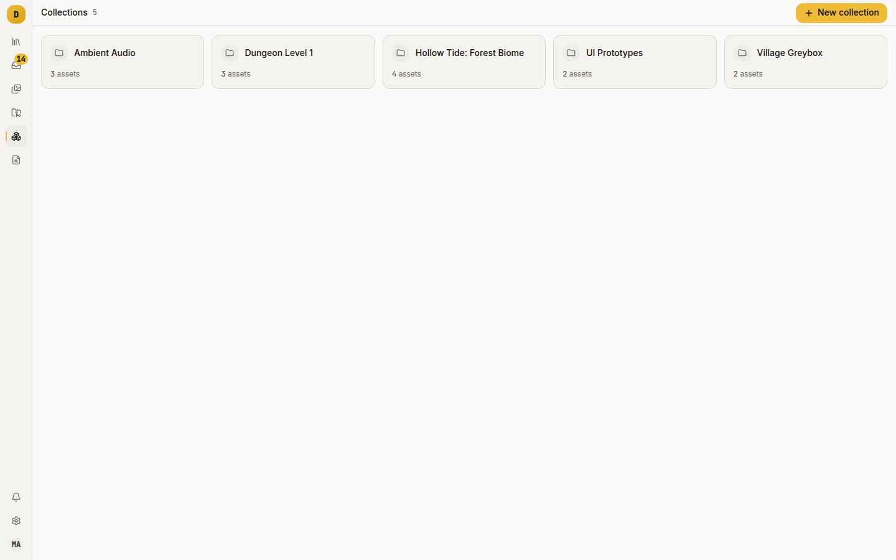
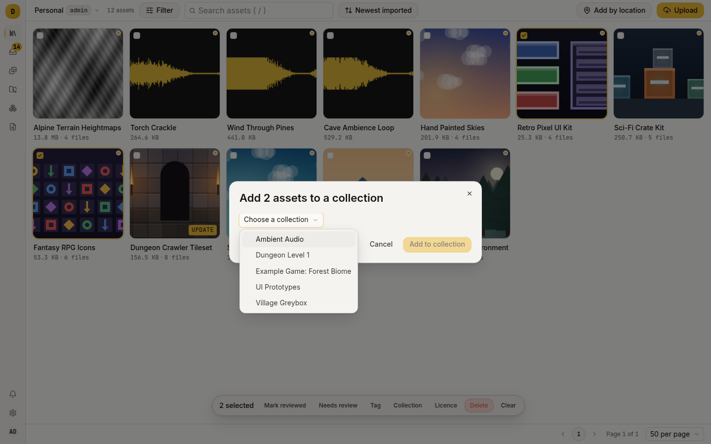
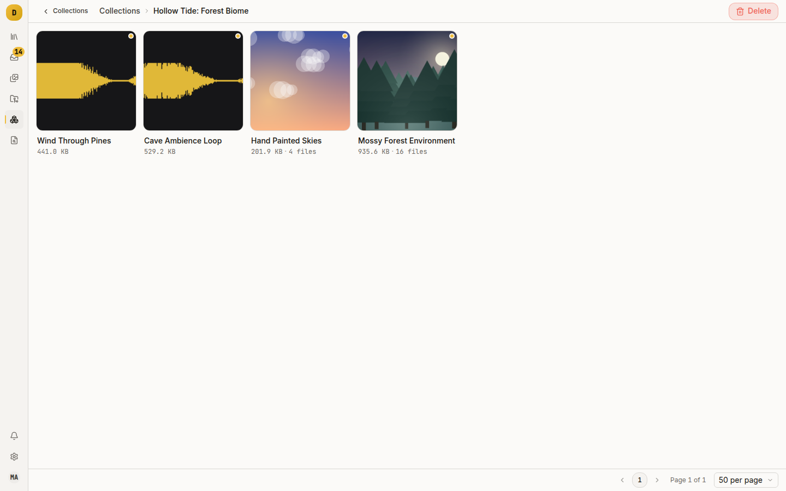

# Group assets you keep coming back to

A collection is a named set of assets inside a library, like a bookmark list: "Boss fight audio", "Things to evaluate", "The kit we use for prototypes". An asset can be in any number of collections, and membership changes nothing else about it.

Use a collection when the grouping is a judgement rather than a fact. Tags describe what an asset is; a collection records what you decided about it.

## Collections, tags and projects

| | What it is | Shape |
|---|---|---|
| Tag | What the asset is, such as `environment/trees/deciduous` | Hierarchical path; searchable; filters the grid, including descendants |
| Collection | What you decided about it | Flat, unordered, many-to-many, no semantics |
| Project | Which version a build is using | One pinned version per asset; tracks updates and licence risk |

If the grouping should be searchable and nest, use a tag. If it names the versions a build depends on, use a project (see [Pin a project to a version you have tested](pin-versions.md)). Otherwise use a collection.

## Make one

Go to **Collections** in the left rail, then **New collection**. Name is required; description is optional. Damson opens the new collection.



Names are unique per library, case-insensitively. A duplicate name is refused with a 409.

From the CLI:

```sh
dmsn collection new "Boss fight audio" --description "Shortlist for the Act 3 fight"
dmsn collections
```

## Put assets in it

An empty collection has an **Add asset** button. It opens a search over the whole library; pick an asset and press **Add**. It adds one asset at a time, and only while the collection is empty.

For more than one asset, or a collection that already has some, use the bulk bar:

1. Go to **Library**. Filter or search down to the assets you want.
2. Hover a card and tick the checkbox at its top-left corner. Once one is ticked, the rest stay visible.
3. Press **Collection** on the bulk bar at the bottom.
4. Choose the collection from the dropdown and press **Add to collection**.



The dialog lists only existing collections, so make the collection first. Up to 1000 assets go in per request, in one transaction. Adding an asset that is already in the collection is a no-op, not an error.

Over the API, one at a time:

```sh
curl -sS -X POST localhost:8080/api/collections/3/assets \
  -H "Authorization: Bearer $TOKEN" \
  -H 'Content-Type: application/json' \
  -d '{"asset_id":42}'
```

In bulk from the CLI:

```sh
dmsn collection add 3 --assets 42,43,44
```

## Take assets out again

In the web UI, open the asset's package page, expand **Collections** and press **Remove** beside the collection's name. There is no confirmation, because the asset is unchanged and you can add it back. From the CLI or API:

```sh
dmsn collection remove 3 --assets 42,43
```

or directly:

```sh
curl -sS -X DELETE localhost:8080/api/collections/3/assets/42 \
  -H "Authorization: Bearer $TOKEN"
```

Removing an asset that is not in the collection is a no-op. The asset itself is unchanged, because membership is only a link row.

## Browse one

Click a collection card to see the library's asset grid filtered to that collection, paged, at the library's default grid density.



The collection page has no Tags or Filters buttons, so you cannot narrow it by tag or licence status there. The API and CLI take `collection_id` alongside every other asset filter:

```sh
dmsn assets --collection 3 --licence-status unk
dmsn assets --collection 3 --updates-available
```

```
GET /api/assets?collection_id=3&licence_status=unk
```

The library page does not read `collection_id` from its URL, so the browser cannot combine the two.

To see which collections one asset belongs to, open it and expand **Collections**.

## Rename or delete one

```sh
dmsn collection edit 3 --name "Act 3 audio"
```

In the UI, the collection page's toolbar has a **Delete** button behind a confirmation: "Assets stay in your library — only the collection is removed." The link rows go; the assets stay.

A collection's description cannot be cleared once set. The update endpoint ignores an empty description, so `--description ""` does nothing. Overwrite it with other text.

## Ideas that work well

- "Needs a decision": a triage inbox for packs nobody has evaluated. It empties over time.
- "Approved for commercial use": a curated shortlist that survives licence rescans, next to the automatic [licence status](track-licences.md) filters.
- "Prototype kit": what you reach for on day one of a jam, so a new starter need not search a library of 2000 packs.
- A shadow of a project: everything you are considering for a build, before any of it is pinned.

Collections are cheap. Counts show on the Collections page and in `dmsn`'s home view, and forty collections slow nothing down.

## Limits

- Once a collection has assets, adding is reachable only through the bulk bar. An asset's own quick look and package page have no "add to collection" button.
- The collection page has no per-asset remove, so unlinking many assets at once means the CLI or API. Check the selection before you add 900 assets to the wrong collection.
- There is no ordering. The grid sorts by the library's rules, not the order you added things.
- Collections are flat. For a hierarchy, use tags.
- Every change is audited (`collection.create`, `collection.update`, `collection.delete`, `collection.add`, `collection.remove`), so an accidental bulk add is traceable in the library audit log.

## Where to go next

- [Pin a project to a version you have tested](pin-versions.md): the grouping that carries meaning.
- [Answer "are we allowed to ship this?"](track-licences.md): how the bulk bar's other actions work.
