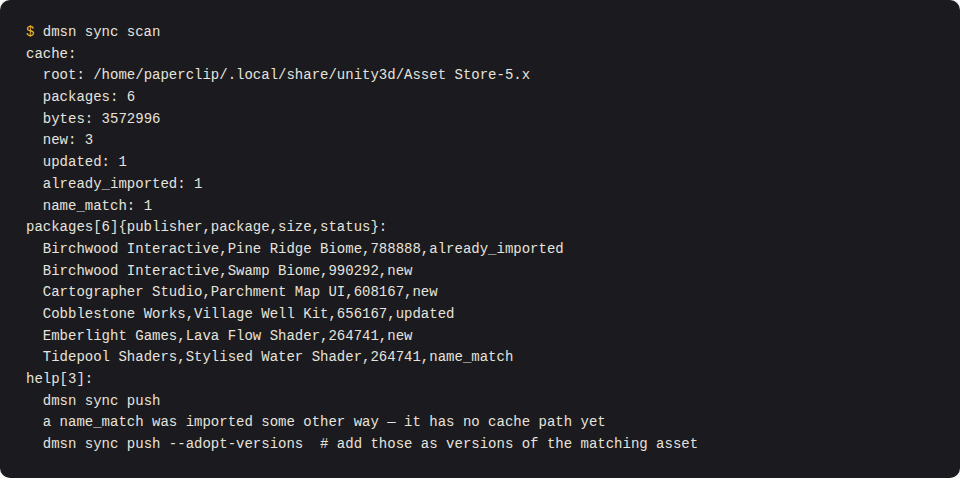
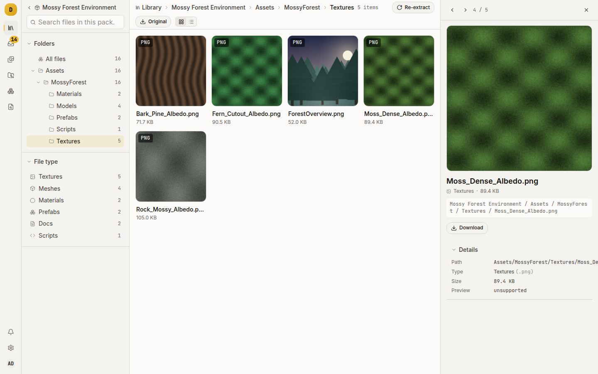

# Get Unity packages in, and see what is inside them

Damson unpacks a `.unitypackage`, lists every file in it, renders previews, and keeps the archive so it can repeat the work later. Use it to catalogue Asset Store purchases, to check whether two packs ship the same tree, or to take one asset out of a 4000-file pack.

If you have not uploaded anything yet, start with [`docs/getting-started.md`](../getting-started.md).

## What Damson does with the archive

A `.unitypackage` is a tar, almost always gzipped, with one directory per asset named after its Unity GUID. Each directory holds an `asset` (the bytes), a `pathname` (where the file goes in a project), an `asset.meta`, and sometimes a `preview.png`.

On import, Damson:

- streams every `asset` entry into object storage, content-addressed by SHA-256, so two packs shipping the same texture store it once;
- reads each `pathname` and uses it as the file's path in the manifest;
- keeps the GUID on the file row;
- ignores `asset.meta` and anything else;
- harvests a cover image from the `preview.png` sidecars.

The cover is the first preview, in tar order, whose GUID is an image file (`.png`, `.jpg`, `.tga`, `.psd`, `.exr` and similar), so the tile is not a mesh icon or a script glyph. If none qualifies, it is the first preview in the archive.

Two kinds of entry are dropped silently:

- A bundle missing its content or its pathname. Real packages carry meta-only stubs, and they have nowhere to go.
- A pathname that is absolute, starts with a drive letter, or climbs out with `..`.

The format is chosen by file extension alone, so a `.unitypackage` renamed to `.7z` is stored as one loose blob and never extracted.

### The caps

Extraction refuses an archive that exceeds any of:

| Cap | Limit |
|---|---|
| One file, uncompressed | 2 GiB |
| All files in the package | 8 GiB |
| Entries in the tar | 200,000 |

Hitting one fails the import at the `extracting` stage with a message naming the cap. These are zip-bomb guards and cannot be set from the environment or Settings. A legitimate pack that trips one needs a code change.

The server-wide **Max upload bytes** (64 GiB by default, under **Settings → Server settings**) caps the transfer and applies before these.

## Import one

Drag the file onto the **Library** page, or press **Upload**. The upload returns once the asset record exists, and the rest runs in the background:

`uploaded` → `extracting` → `detecting` → `thumbnailing` → `enriching` → `done`

Watch it on the **Triage** page. A failed import shows its error there and can be retried, or dismissed to take it out of the queue.

Name the file before you upload it. Damson peels a trailing version token off the filename, so `Forest_Pack_v2.1.unitypackage` becomes an asset called "Forest Pack" with store version `2.1`. A bare trailing integer is not a version: `Rock Set 2.unitypackage` is "Rock Set 2".

## Import the whole Asset Store cache

Unity keeps every downloaded pack in a local cache laid out as `<Publisher>/<Category>/<Name>.unitypackage`. `dmsn sync` reads that layout as metadata.

Build the CLI from a checkout with `just build cli`, then authenticate. Mint a personal access token under **Settings → Access tokens** with `write` scope. The token is pinned to the library that was current when you created it. Store it:

```sh
dmsn login --server https://damson.example.com --token -
```

`--token -` reads from stdin, which keeps the secret out of your shell history and the process list. `DAMSON_TOKEN` also works. `dmsn whoami` shows the identity, library and token in use.

Look first:

```sh
dmsn sync scan
```

This finds the cache, sends the manifest to the server, and prints one row per pack with a status:

| Status | Meaning |
|---|---|
| `new` | The library has never seen this cache path |
| `updated` | Same cache path, different size, so the pack has been updated |
| `already_imported` | Same cache path, same size; nothing to do |
| `name_match` | Nothing at this path, but an asset has that name |

`name_match` means the pack reached Damson another way, probably a hand upload, so it has no cache path. A name alone cannot tell a duplicate from a newer release, so Damson does not guess.

Then upload what is missing:

```sh
dmsn sync push
```

`already_imported` packs are skipped. `updated` packs go up as a new version of the existing asset. `name_match` packs are skipped unless you pass:

```sh
dmsn sync push --adopt-versions
```

Other flags:

- `--dry-run` prints the plan without moving bytes.
- `--publisher NAME` narrows to one publisher.
- `--cache-root PATH` points at a cache outside Unity's usual location (or set `ASSETSTORE_CACHE_PATH`).
- `--concurrency N` sets parallel uploads.
- `--wait` follows each import to a terminal stage.



### What the cache path provides

For a pack imported this way, Damson reads the path and sets:

- the publisher, from the first path segment, only if the asset's publisher is still blank;
- the category, as a tag path, so `3D/Environments/Landscapes` becomes a tag on the asset.

Damson does not parse a version from the filename. The cache holds one file per pack with no version in its name, and a "v2" read from a title like `Tanks v2` would be wrong and would block the real version. Cache imports arrive with no store version. Set one by hand, or let a store lookup fill it (see [Pin a project to a version you have tested](pin-versions.md)).

## Look inside a pack

Open the asset and press **Open package page**. The right side of the page is a file browser: folder tree, listing, and a preview of the file you open. A pack that wraps everything in one folder, such as `Assets/`, opens inside it. You can search and filter by file type. `Esc` steps up a level and then returns to the library. With no file open, the arrow keys step to the previous or next package in the library results. On a narrow screen the page stacks, the files follow the details, and the folder tree and search open from the tree button in the file toolbar.



The UI and API do not expose the GUID Damson recorded for each file. It is in `asset_files.unity_guid` if you need to match a file against a Unity project's `.meta` by hand.

## Pull one part of a pack out

To track part of a pack separately, cut a subset version: a new version of the same asset holding only the files you pick.

1. Open the asset's package page.
2. Tick the files you want.
3. Press **Create subset** in the selection bar at the bottom.

The new version points at the same stored objects, so no bytes are copied, and its notes record the version it was cut from. It has no archive of its own. **Download original** and **Re-extract files** keep working because they target the newest version that still has an archive, not the current one.

A subset is a version, so it competes to be the asset's current version, and the file browser shows the current version's files. A version with a dotted store version always outranks one without. A subset cut from a pack that has a store version does not become current. Cut one from an asset where no version has a store version and it does, by import date. Check **Versions** to see which is marked current.

## Get the original archive back

If the library keeps originals (**Settings → Storage → Retain original packages**, on by default), the asset's quick look and package page show **Download original**. It returns the newest version that still has its archive, named after the asset.

**Re-extract files**, in the package page's **Maintenance** menu, rebuilds the file manifest from the retained archive without creating a version. Use it when extraction was wrong or incomplete and a fix has shipped. It works on Unity packages only, not zips, and the SPA follows it with a preview requeue so previews return too.

Both disappear once the archive is gone.

### Turning off retention

Turning **Retain original packages** off reclaims a lot of space, because the archive is a second full copy of the files you browse. The cost:

- **Download original** and **Re-extract files** stop working for anything imported after the change.
- The setting is read at import time only. Turning it off does not purge existing archives, and turning it on again does not restore purged ones. To get one back, upload it again.
- Archives are content-addressed. If two assets were imported from the same bytes, Damson deletes the object only when no live version references it.

## Covers

A Unity pack's tile is the preview image harvested from the archive. With **Settings → Thumbnails → Unity preview harvest** off, Damson ignores it and uses the storefront cover, or the placeholder if enrichment found nothing.

A storefront cover always wins over a harvested one and is never regenerated over. A rescan or re-extract leaves it alone.

## Things that will catch you out

- Zips are extracted too, by a different extractor with the same caps. Browsing, subsets and originals work the same, except re-extract.
- An entry with an unsafe pathname is skipped without a report. If a file is missing from the manifest and the import said `done`, this is the likeliest reason.
- Thumbnailing and enrichment never fail an import. A pack with no cover and no storefront data is a successful import.
- A `.unitypackage` that is a plain tar works. Damson checks the first two bytes for the gzip magic and otherwise reads tar.
- Deleting an asset leaves its blobs. Reclaiming them is the sysadmin's storage cleanup, documented in [`docs/configuration.md`](../configuration.md). An import deletes a stored object itself only in the original-archive purge described under [Turning off retention](#turning-off-retention), and only once no other live version points at that archive.

## Where to go next

- [Answer "are we allowed to ship this?"](track-licences.md): Asset Store packs all land on the same EULA.
- [Pin a project to a version you have tested](pin-versions.md): what to do once `dmsn sync` brings in updates.
- [`docs/architecture.md`](../architecture.md), Import pipeline: the stages and their traps.
