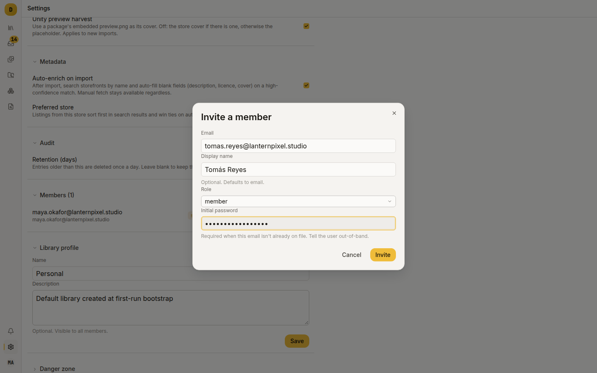
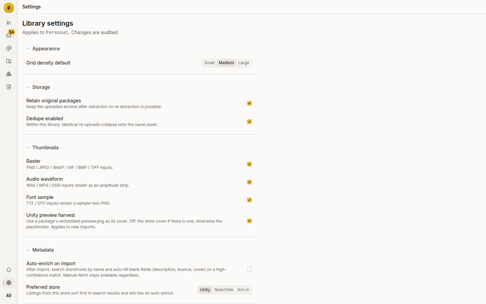

# Invite your team

A team shares one library. Everyone you invite sees the same assets, tags, projects, collections, settings and audit log, and nobody sees anything until they are a member.

## Add people

Go to **Settings → Members**, then **Invite**. You must be a library admin or a sysadmin. The dialog takes an email, an optional display name, a role and, in local auth mode, an **Initial password**.

The result depends on whether the person has an account:

- They have one: leave the password blank. They are added to the library with the chosen role.
- They have none, in local auth mode: supply a password of at least 8 characters, and Damson creates the account and membership together.
- They have none, in OIDC mode: the invite fails with "user not found — they must sign in once before being invited". Your IdP holds identities, so Damson cannot create accounts. The person signs in first, sees "No library access yet", and you then invite them.

The next time they sign in or reload the page, they land in the library. There is nothing for them to choose.

Inviting an existing member returns 409.

## Two role hierarchies

| | Values | Scope |
|---|---|---|
| `library_memberships.role` | `admin`, `member` | The library |
| `users.role` | `user`, `sysadmin` | The whole instance |

They are independent. A sysadmin is not automatically a member.

A library admin can edit library settings, rename the library and invite, re-role and remove members. A member can do everything else (upload, tag, pin, curate) and can read the settings screen without changing it.

A sysadmin can administer the library (invite, re-role, rename) without being a member, and gets the **Server settings**, **Users**, **Storage cleanup** and server-wide audit screens. A sysadmin cannot read the library's contents without joining it.

## Change a role, or remove someone

Both are on the **Members** list. Damson refuses to demote or remove the last admin. The UI disables those controls with an explanatory tooltip, and the API returns 409.

Removing a member deletes the membership and invalidates every token and session that user holds, so an open tab cannot keep reading from cache. Their next request fails and the SPA sends them to sign in. If they sign in again, the Library page shows "No library access yet".

## Settings

**Settings** configures the library and names it under the heading. A library admin gets the form. A member sees the same values read-only, with "You have read-only access — ask a library admin to edit."

The sections are **Appearance** (grid density default), **Storage** (retain original packages), **Thumbnails** (raster, audio waveform, font sample, Unity preview harvest), **Metadata** (auto-enrich on import, preferred store) and **Audit** (retention in days).

Every change is audited. [`docs/configuration.md`](../configuration.md) has the full table of settings, including the one with no control surface.

**Settings → Library profile** renames the library and edits its description.

## Things that will catch you out

- A user with no membership can sign in and has nowhere to go. They see "No library access yet" with their email. There is no "everyone can see everything" mode.
- A 403 is about you and a 404 is about the resource. If you are not a member, every library-scoped route returns 403 before looking at the request. Asking for an asset the library does not have returns 404.
- Audit is per library (**Audit log** in the rail), plus a server-wide feed for sysadmins. Retention is a library setting; unset keeps entries forever.

## Where to go next

- [`docs/configuration.md`](../configuration.md): every library and server-wide setting, and the OIDC setup.
- [`docs/architecture.md`](../architecture.md), Authentication and authorisation: the rules behind all of this.
