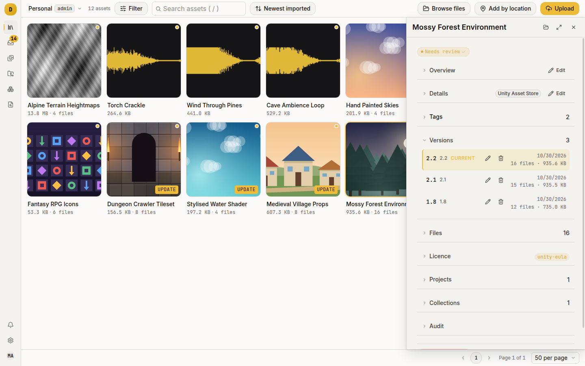
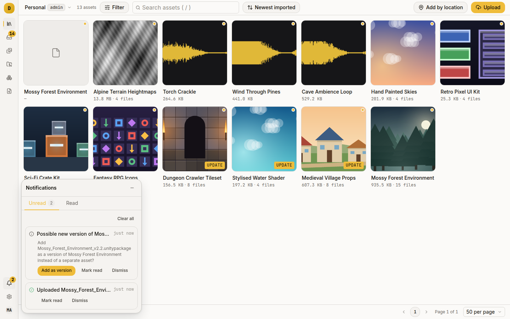
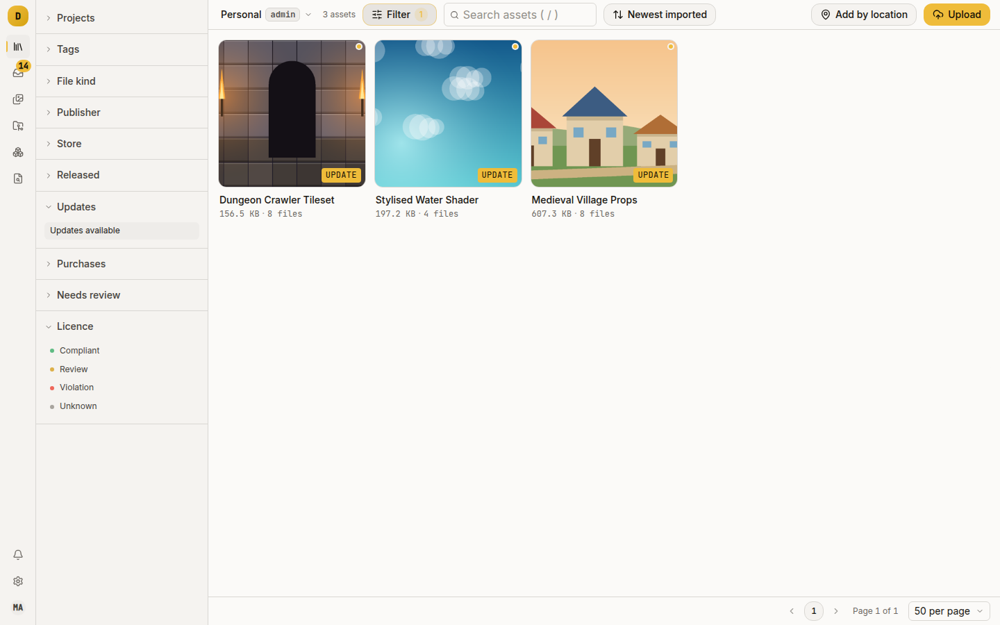
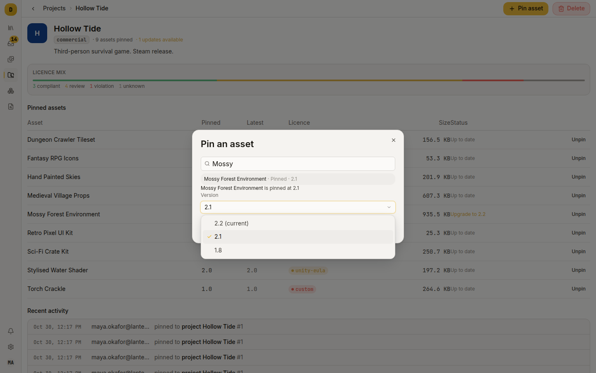
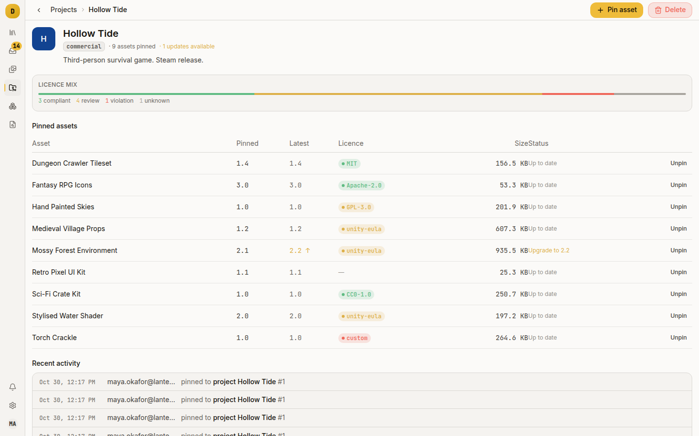

# Pin a project to a version you have tested

Damson keeps every version of a pack you import, and a project records which one it uses. An upgrade then becomes a decision you make. Use this when several builds depend on one library, when you are about to take an update and want a way back, or when you need to know which version is in the shipped game.

## How versions work

An asset owns versions and a version owns files. Nothing is replaced: a new import of the same pack adds a version beside the old one, and each keeps its own file manifest.

A version has two fields:

- Store version: a dotted number such as `2.1` or `1.10`. Damson orders by this. It must parse as dotted integers (a leading `v` is stripped) or it is not stored.
- Version label: free text such as `shipped`, `pre-HDRP` or `trimmed`. Damson shows it and never uses it for logic.

The current version is the one the asset's Files section and grid tile describe, and the one a pin defaults to. Damson picks it in this order:

1. the highest parseable store version;
2. otherwise the newest import date;
3. otherwise the highest row id.

A version with a store version always outranks one without, whatever the dates. A version whose files have not finished landing is passed over, so a half-finished import never becomes current.



## Add a version

From the CLI, name the asset you are adding to:

```sh
dmsn upload ForestPack.unitypackage --asset-id 42
```

`dmsn sync push` does it automatically: a cache package whose path Damson already holds at a different size comes in as a new version of that asset. See [Import Unity packages](import-unity-packages.md).

In the web UI there is an extra step. An upload always creates a new asset. Damson then checks the name against the library and, when it matches an existing asset exactly (lower-cased, punctuation collapsed to spaces), raises a notification:

> Possible new version of Forest Pack — Add `Forest_Pack_v2.2.unitypackage` as a version of Forest Pack instead of a separate asset?

Press **Add as version** and Damson re-sends the file attached to that asset, then deletes the standalone asset it created. If you ignore the notification, you keep two assets.



An asset cannot hold two versions with the same store version. A second upload at `2.1` is refused with a 409 telling you to delete or replace the existing one. Two versions with no store version are fine.

## Fix a version's numbers

Open the asset's package page, expand **Versions** and press the pencil on a row. Edit the store version and label, then press the tick to save or the cross to cancel (Enter saves, Escape cancels).

The store version must be a dotted number. `2.1-beta` is rejected with "store_version must be a dotted number like 1.1". Put it in the label instead.

Editing a store version does not re-pick the current version. That choice runs on import, version delete, merge and subset, not on edit. If you correct a store version and the wrong version is still current, delete and re-import, or trigger one of those other operations.

## Know when a pack has been updated upstream

Damson compares the latest store version it last read from the storefront with the highest store version you hold. When the store is ahead, the asset is flagged as having an update available.

The comparison is numeric, so `1.10` is newer than `1.9`. A value that does not parse on either side is ignored, so:

- an asset with no orderable store version is never reported as out of date, because Damson does not know what you hold;
- a deprecated listing is excluded, because the store will publish nothing newer.

This can miss an update but never reports a false one.

To refresh what Damson knows, run a store lookup. The web UI has no control for this; use the CLI or API:

```sh
dmsn asset refresh 42                      # one asset, waits for the result
dmsn bulk refresh --assets 1,2,3           # several
dmsn bulk refresh --store unity            # everything matching a filter
```

A refresh fills blanks and replaces what the last lookup wrote, but never a field a person has edited. It reports those as kept. Lookups run one at a time on the server, and stopping `dmsn` stops the waiting, not the work. `dmsn bulk refresh --batch <id>` picks the report up later.

You can also type the number yourself. The package page's **Edit details** form has a **Store version** field that writes the same `latest_store_version`.

Then find the assets:

- **Library → Filters → Status → Updates available**, or
- `dmsn assets --updates-available`.



## Set up a project and pin to it

A project is a named set of pinned asset versions inside one library: a game, a build, a demo. Go to **Projects → New project**. Give it a name and optionally a target distribution: `commercial`, `open-source`, `personal` or `unspecified`. Damson records and displays it but enforces nothing against it.

To pin:

1. Open the project.
2. Press **Pin asset**.
3. Search for the asset, pick a version from the dropdown, and confirm.



Over the API, omitting the version pins the asset's current version:

```sh
curl -sS -X POST localhost:8080/api/projects/1/pins \
  -H "Authorization: Bearer $TOKEN" \
  -H 'Content-Type: application/json' \
  -d '{"asset_id":42}'
```

A project has one pin per asset, so it cannot hold two versions of the same pack. Pinning an already pinned asset moves the pin in either direction and is audited as a change, not a new pin.

Pinning is available in the web UI and API. `dmsn` has no project command.

## Read the project page

The **Pinned assets** table has a row per pin:

| Column | What it tells you |
|---|---|
| Asset | Links to the asset |
| Pinned | The version label of the pinned version. Blank if it has none |
| Latest | The version label of the asset's current version, amber with an ↑ when it differs from Pinned. `—` if that version has no label |
| Licence | The licence pill, so a problem is visible without leaving the page |
| Size | The pinned version's bytes |
| Status | **Up to date**, or an **Upgrade to 2.2** button |

**Upgrade to 2.2** moves the pin to the asset's current version in one click. Nothing is downloaded or deleted, because a pin is a pointer.

The table shows the version label, not the store version. A version that has only a store version, which is every version an upload creates, shows a blank Pinned cell and `—` under Latest, and its upgrade button reads "Upgrade to" with nothing after it. Give each version a label (see [Fix a version's numbers](#fix-a-versions-numbers)) and the table reads as above. The screenshot's labels match its store versions.



"Latest" means the newest version in your library, not on the store. The project page answers "am I on the newest version we have imported"; the Updates available filter answers "is there a newer one we have not imported". A pack can be current by one and behind by the other.

The header shows the same counts in aggregate: `N assets pinned`, and `N updates available` in amber when any pin is behind.

## Unpin, and get out of a corner

**Unpin** on a row removes only the pin. The asset stays in the library and other projects keep their own pins.

A pinned version cannot be deleted. Damson refuses with "version is pinned by N project(s); unpin before deleting", so a project's dependency cannot be destroyed underneath it. Move or remove the pin first.

Deleting the whole asset removes its pins through the database cascade. Deleting the project removes its pins and leaves every asset untouched.

## Reference assets

A reference asset records a pack you have not imported, as a path on a NAS, a store link, or both, so the catalogue is complete without the bytes in Damson. It has no versions.

A pin on one carries no version. The project page shows `Reference` in the Pinned column and an em dash in Size, because there are no bytes to measure. Pinning the same reference twice is a no-op, and passing a `version_id` for one is a 400.

## Things that will catch you out

- Store version and label are not interchangeable. Only the store version orders versions and drives the updates-available comparison. A label of `2.1` does nothing.
- A subset version has no store version, so it becomes current only when no other version of that asset has one. See [Import Unity packages](import-unity-packages.md).
- An asset with no store version on any version never appears under the updates-available filter. For upgrade tracking, give versions numbers.
- Cache imports arrive unversioned on purpose. `dmsn sync` suppresses filename version parsing, because the Unity cache has no versions in its filenames and a phantom one would block the real one permanently.
- Every pin change is audited (`project.pin`, `project.pin.change`, `project.unpin`) and shows in the project's **Recent activity** panel and the library audit log.

## Where to go next

- [Answer "are we allowed to ship this?"](track-licences.md): the Licence mix bar on the same project page.
- [Group assets into collections](collections.md): a grouping that is not about versions.
- [`docs/architecture.md`](../architecture.md), Data model: versions, pins and the rules around them.
