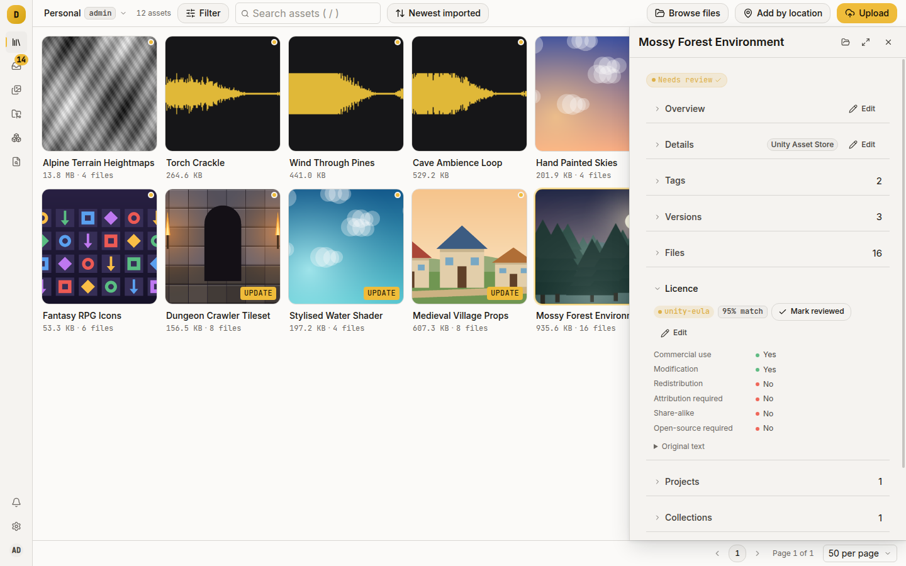
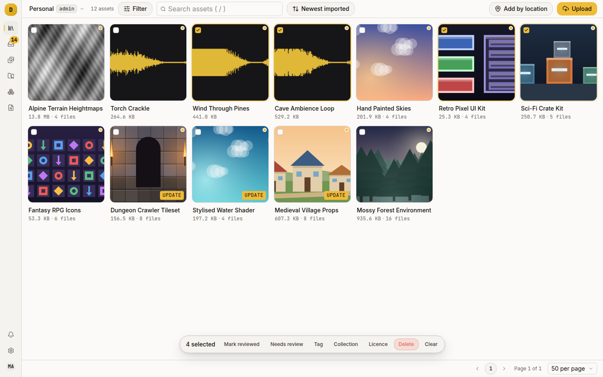
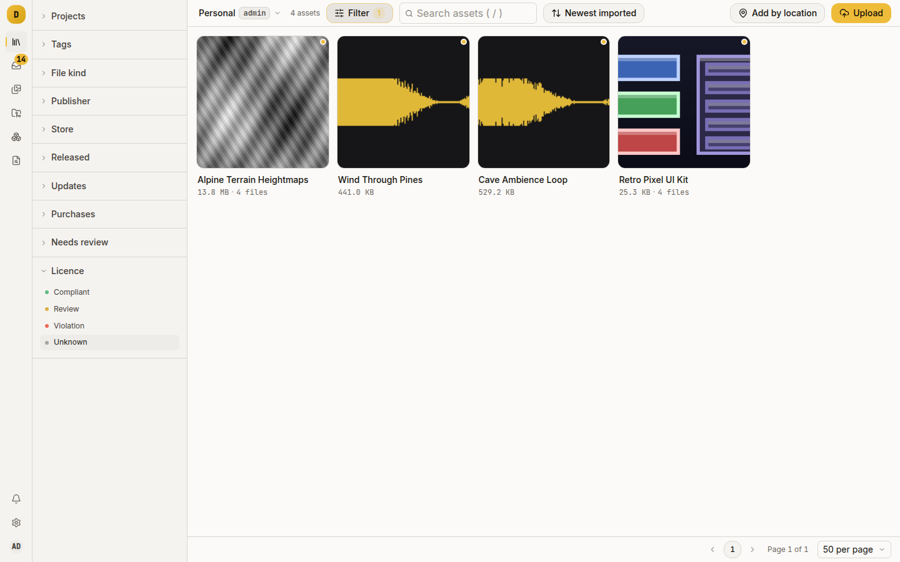
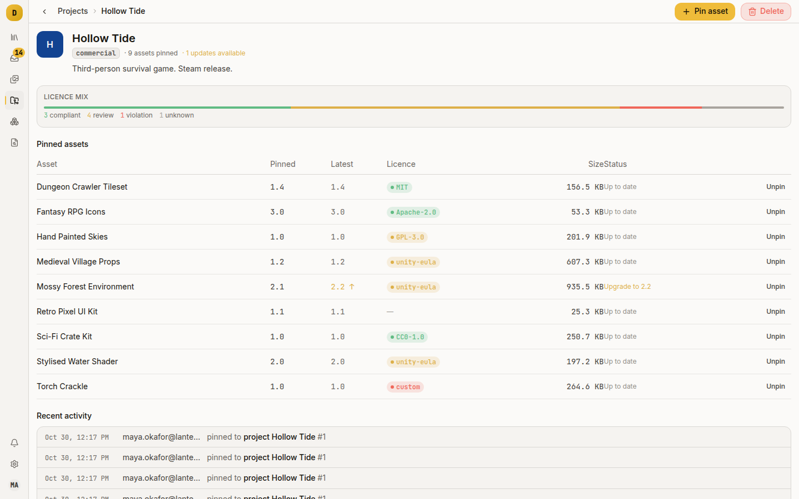

# Answer "are we allowed to ship this?"

Damson tracks one licence per asset, with the terms broken out as six yes/no/unknown attributes. You can filter a library by what its licences permit, and see whether anything in a project blocks a commercial release. Use it before a release, when someone asks where a model came from, or after importing a hundred packs when you want to know which nobody has looked at.

This guide assumes a library with assets in it. See [`docs/getting-started.md`](../getting-started.md) if you have none.

## What Damson stores

An asset has at most one licence row. It holds:

- the original text, verbatim, always;
- a detected type: an SPDX id (`MIT`, `GPL-3.0`, `CC-BY-NC-4.0`), `unity-eula`, `custom` or `unknown`;
- a confidence and, when the text was edited away from the canonical wording, a note saying so;
- six attributes, each `yes`, `no` or unknown: commercial use, modification, redistribution, attribution required, share-alike, open-source required;
- a review mark: who confirmed it, and when.

Unknown is a third state, not a `no`. Damson never guesses an attribute it cannot derive from the detected type, and the UI shows the difference: a licence that says nothing about redistribution is not one that forbids it.

## The four statuses

Every screen that summarises licences uses the same four:

| Status | Label in the UI | What puts an asset here |
|---|---|---|
| `ok` | Compliant | A permissive type, and commercial use is not barred |
| `warn` | Review | A licence with terms a human should read |
| `err` | Violation | Commercial use is explicitly `no` |
| `unk` | Unknown | No licence, or a type of `unknown` |

"Permissive" is a fixed list in the code: `MIT`, `BSD-2-Clause`, `BSD-3-Clause`, `Apache-2.0`, `Zlib`, `ISC`, `CC-BY-4.0`, `CC-BY-3.0`, `CC0-1.0`, `OFL-1.1`, `Unlicense`. Every other licensed asset is **Review**, including `unity-eula` and the GPL family. A Unity Asset Store pack is usually fine to ship inside a game and never fine to redistribute on its own, and Damson does not collapse that into a green tick.

A freshly imported library of Asset Store packs is therefore almost all **Review**. That is correct. Your job is to turn it into reviewed **Review**. On an asset's panel and package page, a **Review** licence is a plain label with no dot, because there orange means the asset needs review, and a licence with terms to read is not a fault.

## Where a licence comes from

Four writers, with unequal authority:

1. Import enrichment. When the storefront listing states a licence, the `enriching` stage writes it. A Unity Asset Store listing yields `unity-eula` with its published terms: commercial use yes, modification yes, redistribution no.
2. A rescan. **Rescan package**, in the **Maintenance** menu on the asset's package page, looks in the current version's files for one named `LICENSE`, `LICENSE.md`, `LICENSE.txt`, `COPYING`, `COPYING.LESSER` or `UNLICENSE`, matched case-insensitively anywhere in the tree and preferring the shallowest. It reads the first 128 KiB and runs the detector over it.
3. A store lookup. `dmsn asset refresh` and `dmsn bulk refresh` re-read the listing and apply it.
4. A person, from the asset's package page or the bulk bar.

The first three are automatic writers. An automatic writer never replaces a licence someone has marked reviewed, so a later rescan cannot undo your answer.

A person's write always replaces what was there and clears the review mark, because the reviewed licence is gone.



## Set a licence by hand

Open the asset, press **Open package page**, and expand **Licence**. The quick look shows the licence on one line; editing it is on the package page.

If the asset has no licence, you get a textarea:

1. Paste the licence text.
2. Press **Detect**. Damson shows the type, confidence and attributes it would store, without saving.
3. Press **Save detected** to take the detector's answer, or **Save as custom** to keep your text as type `custom` with no attributes set.

If the asset has a licence, press **Edit** in the licence header. You can change the text and set each attribute to **Yes**, **No** or **Unknown**. Two rules apply:

- After changing the text, Save is unavailable until you press **Detect** again, so the saved type always matches its text.
- Save is unavailable until something changes. Any save replaces the licence row and clears its review, so Damson refuses a no-op.

A save never stores the type `unknown`. If the detector finds no match, the form saves `custom` and keeps the attributes you set, because the status rule ignores the attributes of an `unknown` licence and a licence you described should count.

## Mark it reviewed

Press **Mark reviewed** in the licence header. It records you and the timestamp and shows a **reviewed** badge. After that, no rescan, import enrichment or store lookup overwrites the licence.

Reviewing does not change the status. A reviewed `unity-eula` is still **Review**: the status describes the terms, and the review mark records that a human read them.

> This differs from the asset-level **Needs review** chip. A new import sets that flag, and it covers the whole asset (name, tags, metadata), not just the licence. Clear it by clicking the chip, or with **Mark reviewed** on the bulk bar.

## Do a whole batch at once

When assets share a licence, such as everything from one publisher, set it in one go.

1. Go to **Library**.
2. Hover a card and tick the checkbox at its top-left corner. More checkboxes appear once one is ticked.
3. Press **Licence** on the bulk bar at the bottom.
4. Paste the text and press **Apply licence**.



The bulk action always runs the detector over the pasted text and stores its answer, with no "save as custom". It is one transaction over up to 1000 assets. It counts as a person's write, so it replaces reviewed licences too. Each asset gets its own audit entry.

## Find the assets that need you

Open **Filters** on the library toolbar. Its **Licence** section has one row per status: **Compliant**, **Review**, **Violation**, **Unknown**. Click one to filter the grid, and click it again, or the chip under the toolbar, to clear it.



Start with **Unknown**. Damson knows nothing about those assets, whereas the answer for a **Review** one is merely unreviewed.

To filter by one exact licence type, add `spdx=` to the library URL by hand. The page reads the parameter and shows it as a chip, but nothing in **Filters** sets it.

```
/library?spdx=GPL-3.0
```

From the CLI:

```sh
dmsn assets --licence-status unk
dmsn assets --licence GPL-3.0
```

## Answer the question for a project

A project is a set of pinned asset versions (see [Pin a project to a version you have tested](pin-versions.md)). Once something is pinned, its page opens with a **Licence mix** bar: a stacked bar with counts of compliant, review, violation and unknown across every pin.



Each row in the **Pinned assets** table shows its asset's licence pill. A non-zero violation count on a project whose target distribution is `commercial` means stop and look.

Set the target in the project's **Target distribution** field: `commercial`, `open-source`, `personal` or `unspecified`. Damson records and shows it but enforces nothing against it. You enforce it by reading the bar.

## Things that will catch you out

- Status is derived, never stored. Change an attribute and every count moves. There is no separate "approved" flag to fall out of sync.
- A rescan can find only a licence file that was extracted. A loose upload, or a pack with no file under the six recognised names, gives the detector nothing to read. Paste the text instead. Depth is not a problem: a `LICENSE` four directories down is found.
- Rescan never overwrites a reviewed licence. If it reports no change on an asset that plainly has a `LICENSE` file, check whether the licence is already reviewed.
- Damson matches Unity's EULA by fingerprint, not a full SPDX match. It looks for "Unity Asset Store" plus "End User License Agreement" or "EULA" in the first 4 KiB, and stores the Asset Store's published terms. This is a heuristic and you can override it.
- `custom` means a human described the licence. It is not a failure state; `unknown` is.
- Every licence write is audited (`asset.licence.set`, `asset.licence.update`, `asset.licence.review`) and shows in the asset's **Audit** section and the library audit log.

## Where to go next

- [Import Unity packages](import-unity-packages.md): where most `unity-eula` rows come from.
- [Pin a project to a version you have tested](pin-versions.md): the other half of the shipping question.
- [`docs/architecture.md`](../architecture.md), Licence detection: the rules behind all of this.
