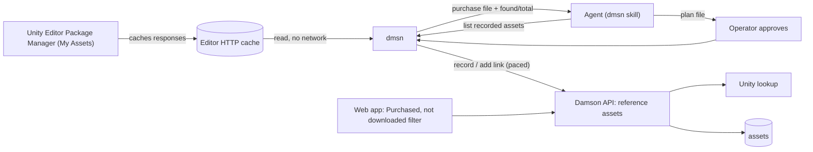
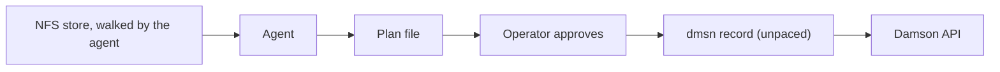
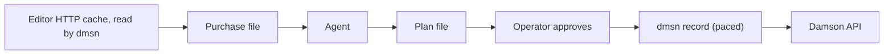

# Catalogue my purchases: reading the Unity purchase list

## Why are we doing this

So that everything bought on the Unity Asset Store is in Damson and can be found by search, whether
or not it was ever downloaded. This design settles where the purchase list is read from, and how a
purchase joins an asset Damson already records.

## Tasks covered

- DAM-3 — Catalogue my purchases. Builds on DAM-2 (reference assets, PR #1) and DAM-1 (NFS agent
  scan, PR #2).

## Steering

- Allow having assets added that don't have their data imported, they are just the links to where
  they exist on the file system. — Initiative, 2026-10-03
- Assets which I have purchased from Humble Bundle or Unity Asset Store. These may not be
  downloaded, but I want to collect them in the library, along with their metadata (as much as
  possible) so that I can easily find the asset. This would be the perfect use for the scraper.
  — Initiative and Task, 2026-10-03
- I think it is worth looking at the workflow on how the metadata calls will be made. Thousands of
  assets means thousands of calls, and it may be better to spread that out or do that out-of-band,
  make a file with all the metadata/possible matches, rather than have it in the loop with the agent
  where it could be rate limited. — Session (DAM-1), 2026-10-05
- the only store page we need is Unity - Humble bundle out of scope — Session, 2026-10-05
- Unity we should see if we can use the app's local store — Session, 2026-10-05
- it is acceptable to say I need to run load all for it — Session, 2026-10-05

The 2026-10-05 session steering narrows DAM-3's signed-off Direction. Humble Bundle, its bundle
tag, and its covers and product links are out of scope. The rest of the Direction still binds: the
agent drives dmsn, plans first and records only after approval; a match is by the same store link,
or the same name and publisher; no path means Purchased, not downloaded; everything is Needs review.

## Behaviour

Before: purchases reach Damson only one at a time, by hand, as link-only reference assets. Nothing
reads the Unity purchase list, and nothing lists the assets that were bought but never downloaded.

After:

- dmsn reads the Unity purchase list from the Unity Editor's local HTTP cache. It makes no network
  call to Unity and handles no Unity credential. It writes a purchase file and says how many of the
  list's total it found.
- WHEN the cache holds fewer purchases than the list's total THEN dmsn reports the shortfall, and
  the operator runs Load all in Package Manager's My Assets and runs it again. The agent plans
  only from a complete list, unless the operator tells it to go ahead.
- The agent writes a plan with one row per purchase: new, matched to an existing asset (and which
  one), or dropped. Chat shows the counts and anything the agent is unsure of. Nothing is recorded
  until the operator approves.
- WHEN a purchase matches an asset with no store link THEN that asset gains the purchase's link.
- WHEN a purchase matches an asset that already has a different store link THEN the plan shows the
  conflict, and the existing link is kept unless the operator says otherwise.
- A new purchase is recorded as a reference asset with its Asset Store link. The existing Unity
  lookup fills its metadata and cover.
- Store lookups during recording are spaced out like DAM-1's match step, so a run over hundreds of
  purchases is not throttled.
- Filtering on Purchased, not downloaded shows exactly the reference assets with no path.
- Everything a run records or changes is marked Needs review.

## Architecture

The boundary is the purchase file. dmsn reads Unity's purchase list from the cache the Editor has
already filled, on the machine where the Editor runs. Everything after the file follows the DAM-1
pattern: a file the agent reads, a plan the operator approves, and one dmsn step that records it.

The cache is the Editor's own HTTP response cache, at
`~/Library/Caches/com.unity3d.UnityEditor/CurlRequestCache.db` on macOS: SQLite, one row per URL.
On this machine, on 2026-10-05, it held:

- Package Manager's purchase list pages (`packages-v2.unity.com/-/api/purchases?offset=…&limit=…`).
  Each page gives `total` (429 here) and, per purchase, `id`, `packageId`, `displayName`,
  `grantTime`, `isHidden`, `isPublisherAsset`, `orderId` and `tagging`. There's no publisher.
- Product details (`/-/api/product/<id>`) only for items opened in Package Manager. These include
  `productPublisher`, `slug` and images.
- Before Load all, only the first page of the list (offset 0): about 25 of the 429 purchases.
  After the operator ran Load all in My Assets, the cache held every purchase: 429 distinct
  purchases against `total` 429, with the rest fetched as one page (`offset=20&limit=409`).
- `packageId` is the Asset Store listing ID. For all 75 cached products, it ends the listing slug
  (`toony-skies-11020`), it's the ID in the product URL, and it matches a purchase's `packageId`.
  The purchase's `id` is an internal number, not the listing ID.

The local `Asset Store-5.x` folder holds downloaded packages only, so it can't list purchases.

Modules affected, and what each becomes responsible for:

- **`cmd/dmsn`** — reads the purchase pages from the Editor cache, merges them by purchase ID,
  writes the purchase file, and reports how many it found against `total`. It accepts an explicit
  cache path, as the Unity cache import does for `Asset Store-5.x`
  (`docs/specs/history/2026-08-01-unity-local-cache-import.md`). It carries the purchase-run
  instructions, installed by `dmsn setup` next to the scan instructions. It lists every recorded
  asset's name, publisher, store link and store product ID, so the agent can match. It records an
  approved plan: it creates new reference assets, adds a link to a matched asset, and spaces out
  calls that trigger a store lookup.
- **`internal/handlers/api` (asset list, `assets.go`)** — gains a filter for reference assets with
  no path, next to the existing `needs_review`, `store` and `publisher` filters.
- **`web/`** — offers that filter in the library. Where it sits in the UI is `/ui-design`'s call if
  it isn't obvious from the existing filters.

Recording itself needs no server change. `POST /api/assets/references` already takes a link-only
record, and the Unity adapter (`internal/services/metadata/unity.go`) reads the trailing numeric ID
from any listing URL.

Matching follows the Direction. "Same store link" compares the Unity product ID where the existing
asset has one (`internal/models/asset.go`: `Store`, `StoreProductID`), and otherwise the exact link.
The server's link-only check (`assets_reference.go`) compares exact strings only. "Same name and
publisher" can't be checked from the purchase list, which has no publisher. A name-only match goes
in the plan as unsure, for the operator to confirm. It is never matched silently.

Data flow, current (DAM-1 scan) and intended (purchase run), with the same nodes:

There is no standing architecture doc for the agent-run pattern. Together, DAM-1 and this design
are the candidate for one.

## Options

| Option | Touches | Observable change | Cost | Risk | Forecloses |
| --- | --- | --- | --- | --- | --- |
| **A. Read the Editor's HTTP cache** (recommended) | dmsn (cache reader, instructions, record), asset list, web | Operator runs Load all in Package Manager's My Assets; dmsn reads the cache and reports found/total | Lowest. A read-only SQLite read, with no credentials and no network | The cache format and Package Manager's endpoint are undocumented. It holds only the pages loaded, and entries may expire | Runs on a machine without the Editor |
| B. dmsn calls Package Manager's purchase endpoint itself | dmsn gains a Unity client and reads the Editor's or Hub's stored sign-in | Full list in a few requests, with no scrolling | A Unity client, plus reading a credential Unity stores encrypted | Handles a Unity access token outside Unity. The endpoint is undocumented | Nothing beyond A |
| C. Browser snippet on the Asset Store's My Assets page | dmsn (snippet, instructions, record), asset list, web | Operator runs a snippet in a signed-in browser and saves a file | A snippet to keep working against a web page | The page changes and the snippet breaks | Unattended runs |

A follows the steering ("use the app's local store"), and after Load all the cache held the full
list. dmsn can measure completeness against `total`. B is not recommended, because it takes a Unity
credential out of Unity. C is the fallback if a later Editor stops caching the list.

## Decision

Option A: dmsn reads the Unity purchase list from the Editor's HTTP cache. The operator accepted
calls 1–6 and 8 and rejected call 7.

1. dmsn reads the purchase list from the Editor's HTTP cache, read-only, and reports found against
   `total` (Option A).
2. The agent plans from a complete list only, unless the operator says to go ahead with a partial
   one.
3. A matched asset that already has a different link keeps it. The plan shows the conflict, and
   the operator can swap the link per row.
4. Any asset can be matched, stored or reference. The Direction says "an asset already recorded".
5. A match compares the Unity listing ID (the purchase's `packageId`) before the exact URL. A name-only match is shown as unsure
   and never applied without the operator's say-so.
6. Recording spaces out calls that trigger a store lookup, at DAM-1's default match interval.
7. Purchases marked hidden in My Assets are treated like any other purchase. The operator
   rejected dropping them (2026-10-05).
8. Free assets are included, along with everything else the list holds. `[unsteered]`

Obvious, from the record: Purchased, not downloaded means a reference asset with no path (DAM-3
Direction). A link whose lookup fails is still recorded with the link
(`docs/specs/history/2026-10-03-reference-assets.md`). A rerun leaves recorded assets as they are,
except that a matched asset with no link gains one (`docs/specs/history/2026-10-05-nfs-agent-scan.md`
and DAM-3 Direction).

## Open questions

- Which link form opens the listing when only the `packageId` is known (the purchase list has no
  category path). Settled when building, by opening one. The Unity lookup reads the trailing ID from
  any form.
- Where the cache lives on Windows and Linux. Not checked; an explicit path covers it.

Not checked: whether every Unity lookup so far filled `StoreProductID` on recorded assets, and how
long cache entries survive before the Editor removes them.

## Sign-off

- Signed off by Thomas Elliott, 2026-10-05, on revision 3 (Unity only, Editor HTTP cache).
- Chosen: Option A; calls 1–6 and 8 as recommended. Call 7 rejected, so hidden purchases are
  included.
- Left open on purpose: the link form for a `packageId`-only listing, and the cache path on Windows
  and Linux. Both are settled when building.
- Unsteered constraints accepted: free assets are included (call 8).
- DAM-3's acceptance line "A Humble bundle's items can be found together through its tag" no longer
  applies under the 2026-10-05 steering. The task carries that steering; the line itself is the
  operator's to strike.
